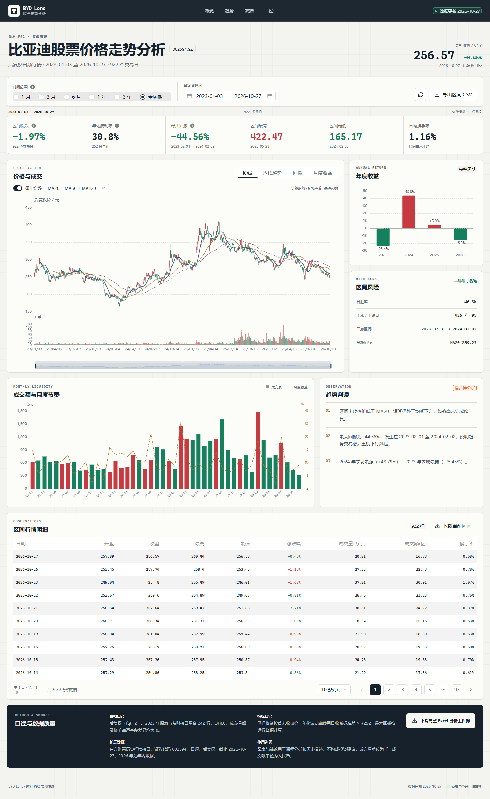

# 比亚迪股票价格走势分析（2023-2026）

教材 P92 实战演练的完整实现：以 2023 年用户 Excel 为起点，补采
2024-2026 年比亚迪 `002594.SZ` 后复权日行情，完成数据核验、指标计算、
Excel 工作簿和交互式网页仪表盘。

GitHub 仓库：
<https://github.com/huashengmi32-a11y/byd-stock-analysis-2023-2026>

在线仪表盘：
<https://huashengmi32-a11y.github.io/byd-stock-analysis-2023-2026/>



## 交付物

- [完整 Excel 分析工作簿](deliverables/比亚迪股票价格走势分析_2023-2026.xlsx)
- [分析报告](docs/分析报告.md)
- [完整 Agent 对话流](docs/对话流.md)
- [完整日行情 CSV](data/比亚迪_后复权日行情_2023-2026.csv)
- [数据校验结果](artifacts/data-validation.json)
- [TDesign MCP 调用证据](evidence/tdesign-mcp/)
- [设计系统](design-system/byd-stock-lens/MASTER.md)

## 数据范围

| 项目 | 内容 |
|---|---|
| 证券 | 比亚迪 `002594.SZ` |
| 频率 | 日频 |
| 价格口径 | 后复权（`fqt=2`） |
| 区间 | 2023-01-03 至 2026-10-27 |
| 观测数 | 922 个交易日 |
| 2026 年 | 截至最后实际交易日的年内数据 |

2023 年原表 242 行与东方财富接口逐字段比对，OHLC、成交量、成交额、
振幅、涨跌幅、涨跌额和换手率的最大绝对差异均为 0。

## 关键结果

| 指标 | 结果 |
|---|---:|
| 2023 首个交易日收盘 | 261.73 元 |
| 最新收盘 | 256.57 元 |
| 全区间收益 | -1.97% |
| 年化波动率 | 30.80% |
| 最大回撤 | -44.56% |
| 区间最高 / 最低 | 422.47 / 165.17 元 |
| 上涨 / 下跌交易日 | 426 / 495 |
| 最新 MA20 / MA60 / MA120 | 259.23 / 271.70 / 278.50 元 |

四年首尾收益接近持平，但路径波动很大。2024 年反弹 43.79%，2025 年
冲高后仅收涨 5.03%，2026 年截至 10 月 27 日下跌 15.22%。完整分析见
[分析报告](docs/分析报告.md)。

## 技术要求落点

- `AGENTS.md`：根目录项目规则、数据口径、UI 约束和验收命令。
- `ui-ux-pro-max`：生成设计系统并补充 chart/UX 查询；拒绝不合适的
  深色营销页结构，落地为页面级分析工作台覆盖。
- `TDesign MCP`：实际调用 `get-component-list`、`get-component-docs`、
  `get-component-dom` 和 `search-icon`，原始返回已保存。
- TDesign Vue Next：RadioGroup、DateRangePicker、Tabs、Select、Switch、
  Table、Pagination、Button、Tag、Tooltip。
- ECharts：K 线、成交量、均线、回撤、月度收益、年度收益。

## 本地运行

首次安装：

```powershell
pnpm install
pnpm build
pnpm preview --port 4174
```

然后打开 <http://127.0.0.1:4174/>。桌面目录中的
`启动仪表盘.cmd` 可直接启动已构建版本。

开发模式：

```powershell
pnpm dev
```

重建数据与 Excel：

```powershell
python scripts/build_dataset.py
python scripts/build_workbook.py
python scripts/validate_data.py
```

浏览器验收：

```powershell
pnpm verify
```

## 项目结构

```text
.
├── AGENTS.md
├── data/                     # 原始、合并、月度、年度与校验数据
├── deliverables/             # Excel 成品
├── design-system/            # ui-ux-pro-max 设计与页面覆盖
├── docs/                     # 分析报告与完整对话流
├── evidence/tdesign-mcp/     # MCP 原始工具与组件文档响应
├── scripts/                  # 数据、Excel 和浏览器验证脚本
├── src/                      # Vue 3 + TDesign + ECharts 仪表盘
├── artifacts/screenshots/    # 375/768/1024/1440 截图
└── dist/                     # 可部署静态构建
```

## 使用边界

本项目是课程数据分析与可视化实战，不构成投资建议。价格数据只支持
历史走势和风险描述，不能单独解释经营、销量、政策或公司公告的因果影响。
